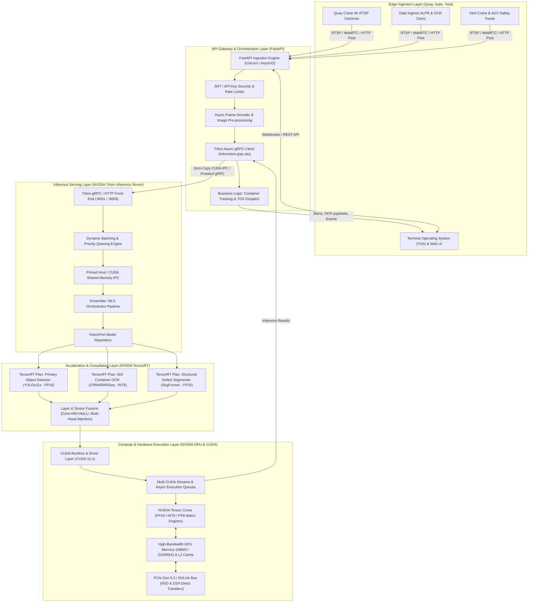
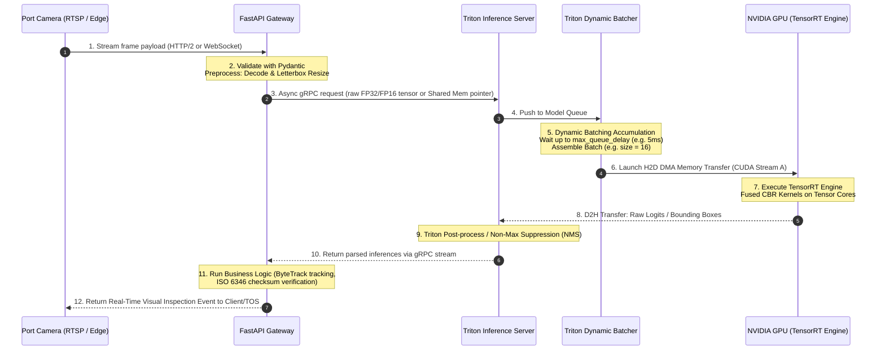

# End-to-End VisionPort Architecture

## 1. Executive Summary & System Overview

**VisionPort** is a mission-critical, enterprise-grade Intelligent Video Analytics (IVA) and Computer Vision platform designed for smart maritime ports, automated container terminals, and intermodal freight logistics hubs.

The system automates:
* **Optical Character Recognition (OCR) for ISO 6346 Container Codes**: Reading 11-character container IDs on top, rear, and sides in real time under diverse weather/lighting conditions.
* **Automated Gate System (AGS) & Access Control**: Identifying truck license plates (ALPR), USDOT numbers, chassis types, and driver cabin safety compliance.
* **Quay Crane Container Alignment & Twistlock Verification**: Assisting crane operators with millimetric alignment and verifying twistlock seating on container ships.
* **Damage & Structural Defect Inspection**: Real-time scanning for container dings, severe rust, punctures, bulging walls, or broken door seals.
* **Quayside & Yard Safety (PPE & Hazard Monitoring)**: Detecting pedestrian workers entering hazardous automated guided vehicle (AGV) lanes or crane travel paths without high-visibility vests or hard hats.

### Core Engineering Requirements
1. **Ultra-Low Latency**: End-to-end inference budget $\le 30\text{ ms}$ per frame for closed-loop crane positioning and gate automation.
2. **High Concurrency & Throughput**: Ingesting and processing over $100+$ high-definition (1080p/4K) RTSP camera streams concurrently ($>3,000 \text{ FPS}$ total system throughput).
3. **Deterministic Performance**: Strict p99 latency boundaries without tail-latency spikes caused by memory fragmentation or CPU-GPU synchronization stalls.
4. **Hardware Saturation**: Maximizing NVIDIA GPU Tensor Core compute and High Bandwidth Memory (HBM) utilization via dynamic batching and zero-copy shared memory transfers.

---

## 2. High-Level Architecture Topology

---

## 3. Deep-Dive: Layer-by-Layer Architecture

### 3.1 Layer 1: Ingestion & API Gateway (FastAPI)
FastAPI serves as the entry point and orchestration layer between external port infrastructure (cameras, gate kiosks, Terminal Operating Systems) and the GPU inference cluster.

* **Asynchronous Non-Blocking I/O**: Built on Starlette and Uvicorn, FastAPI leverages Python's `asyncio` event loop to maintain thousands of concurrent client connections without thread starvation.
* **Pydantic V2 Data Validation**: All incoming requests (image payloads, metadata, camera IDs, timestamp tags) are validated and serialized with compiled C-speed parsing.
* **High-Efficiency gRPC Transport**: Instead of utilizing REST/HTTP 1.1 for internal communications (which incurs JSON serialization overhead and HTTP header bloat), FastAPI communicates with Triton over **HTTP/2 gRPC** using protocol buffers.
* **Shared Memory & IPC Handling**: For localized deployments (FastAPI and Triton co-located on the same physical server or container pod), FastAPI writes decoded raw image tensors directly into **POSIX shared memory (`/dev/shm`)** or **CUDA IPC memory**, passing only memory pointers to Triton. This avoids costly memory duplication over sockets.
* **Application Lifecycle & Health Checks**: Exposes `/health/live`, `/health/ready`, and Prometheus metrics endpoints, polling Triton's internal readiness probes before accepting production ingress traffic.

---

### 3.2 Layer 2: Model Serving & Scheduling (NVIDIA Triton Inference Server)
NVIDIA Triton acts as the enterprise model server orchestrating multi-model pipelines, GPU instance scheduling, and concurrent execution.

* **Dynamic Batching**:
  * VisionPort camera streams arrive asynchronously at varying frame rates. Triton's dynamic batcher aggregates individual inference requests arriving within a configured time window (e.g., `max_queue_delay_microseconds: 5000`) into a single batch up to `max_batch_size: 16` or `32`.
  * Maximizes GPU compute saturation without exceeding the strict latency budget.
* **Concurrent Model Execution & Instance Groups**:
  * Multiple execution instances of the same model engine run concurrently on the GPU using distinct CUDA streams.
  * For example, the primary detector can be configured with `count: 2` instances on `GPU: 0`, allowing one instance to execute compute while the other receives host-to-device memory transfers.
* **Model Ensembling & Business Logic Scripting (BLS)**:
  * VisionPort executes a multi-stage visual pipeline:
    $$\text{Raw Video Frame} \xrightarrow{\text{Preprocess}} \text{Detector (Container Box)} \xrightarrow{\text{Crop \& Normalize}} \text{OCR / Defect Model} \xrightarrow{\text{Postprocess}} \text{Final JSON}$$
  * Rather than round-tripping intermediate tensors back to FastAPI over the network, Triton's **Ensemble Scheduler** chains these models directly inside GPU memory. Intermediate tensors remain in GPU VRAM across model boundaries.
* **Dynamic Model Offloading & Versioning**:
  * Supports zero-downtime hot reloading of models as newer weights are trained and deployed to the `model_repository`.

---

### 3.3 Layer 3: High-Performance Model Acceleration (NVIDIA TensorRT)
TensorRT is the optimizing compiler that converts abstract neural network graph representations (ONNX) into serialized, hardware-specific binaries called **TensorRT Engines (`.plan` / `.engine`)**.

#### Core TensorRT Optimizations:
1. **Layer & Tensor Fusion**:
   * Combines adjacent layers into single execution kernels. For example, `Convolution + Bias + LeakyReLU` or `BatchNormalization` are fused into a single specialized CUDA kernel (CBR), eliminating intermediate VRAM round-trips.
   * Fuses multi-head self-attention projections (Q, K, V) into unified matrix operations in transformer backbones.
2. **Kernel Auto-Tuning**:
   * During engine build time, TensorRT profiles dozens of candidate CUDA implementation algorithms across target GPU Streaming Multiprocessors (SMs) for each layer, selecting the fastest algorithm for the specific batch size and precision.
3. **Precision Quantization (FP32 $\to$ FP16 $\to$ INT8)**:
   * **FP16 (Half Precision)**: Replaces 32-bit floating point with 16-bit representations, delivering up to $2\times$ to $3\times$ throughput speedup on Tensor Cores with negligible accuracy loss ($\Delta \text{mAP} < 0.1\%$).
   * **INT8 Quantization with Calibration**: Compresses weights and activations to 8-bit integers, utilizing Tensor Core INT8 DP4A / Tensor Core operations for up to $4\times$ speedup. TensorRT performs calibration (e.g., KL Divergence / Entropy Minimization) on a representative dataset to prevent dynamic range clipping.
4. **Dynamic Shape Profiles**:
   * Configures optimization profiles for varying input dimensions:
     $$\text{Min Shape} = (1, 3, 640, 640), \quad \text{Opt Shape} = (16, 3, 640, 640), \quad \text{Max Shape} = (32, 3, 640, 640)$$
   * TensorRT optimizes memory allocation and kernel tactics specifically for the `Opt Shape` while preserving flexibility for dynamic batch bursts.

---

### 3.4 Layer 4: Deep Learning Models (VisionPort Workloads)
VisionPort utilizes a heterogeneous suite of specialized vision models:

| Model Role | Architecture | Input Resolution | Output Format | Target Precision |
| :--- | :--- | :--- | :--- | :--- |
| **Primary Container & Vehicle Detector** | YOLOv11x / RT-DETR | $1 \times 3 \times 640 \times 640$ | Bounding Boxes, Class IDs, Confidence Scores | FP16 / INT8 |
| **ISO 6346 Container Code OCR** | CRNN / PARSeq Transformer | $1 \times 3 \times 128 \times 384$ | 11-char container code string + character logits | INT8 |
| **Structural Damage & Rust Segmenter** | SegFormer / Mask R-CNN | $1 \times 3 \times 512 \times 512$ | Pixel-level damage masks (rust, tears, hole punctures) | FP16 |
| **Quayside Safety & PPE Monitor** | YOLOv11-Pose / NanoDet | $1 \times 3 \times 640 \times 640$ | Person keypoints, hard hat / high-vis vest state | FP16 |

---

### 3.5 Layer 5: Hardware & CUDA Execution Engine (NVIDIA GPU)
The physical computation layer executes compiled machine instructions on silicon:

* **Streaming Multiprocessors (SMs)**: Partitioned into sub-cores with dedicated register files, warp schedulers, and execution units.
* **4th/5th Generation Tensor Cores**: Hardware-accelerated matrix multiply-accumulate (MMA) units executing mixed-precision $D = A \times B + C$ operations in single clock cycles.
* **CUDA Streams**: Independent hardware execution queues on the GPU. Triton allocates a dedicated CUDA stream for each model instance, enabling the GPU to overlap:
  1. Transferring Input Batch $N+1$ from Host CPU RAM to GPU VRAM (via DMA over PCIe/NVLink).
  2. Executing TensorRT Kernel Computation on Batch $N$ across Tensor Cores.
  3. Transferring Output Results for Batch $N-1$ from GPU VRAM back to Host CPU RAM.
* **Memory Hierarchy**:
  $$\text{Global HBM3/VRAM (e.g. 24GB-80GB, 2-3 TB/s)} \to \text{L2 Cache (50-100MB)} \to \text{Shared Memory / L1 (128-256KB/SM)} \to \text{Registers}$$
  TensorRT optimizes kernel tiling to ensure high L1/L2 cache hit ratios, preventing global memory memory-bandwidth throttling.

---

## 4. End-to-End Request Lifecycle & Timing Diagram

---

## 5. Performance & Mathematical Formulations

### 5.1 End-to-End Latency Budget
Total request latency $T_{\text{total}}$ is expressed as:
$$T_{\text{total}} = T_{\text{network\_in}} + T_{\text{fastapi\_pre}} + T_{\text{triton\_queue}} + T_{\text{H2D}} + T_{\text{trt\_compute}} + T_{\text{D2H}} + T_{\text{fastapi\_post}} + T_{\text{network\_out}}$$

For a typical VisionPort frame:
* $T_{\text{fastapi\_pre}}$ (Letterboxing, normalization): $\approx 2.5\text{ ms}$ (CPU) or $0.4\text{ ms}$ (GPU via PyTorch/DALI).
* $T_{\text{triton\_queue}}$ (Dynamic batching delay): $\le 5.0\text{ ms}$.
* $T_{\text{H2D}}$ (Host to Device PCIe Gen5 transfer of $16 \times 3 \times 640 \times 640 \times 2\text{ bytes}$ FP16 $\approx 37.7\text{ MB}$): $\approx 0.6\text{ ms}$ (PCIe Gen5 $\times 16 \approx 64\text{ GB/s}$).
* $T_{\text{trt\_compute}}$ (YOLOv11x FP16 on Tensor Cores, batch 16): $\approx 11.2\text{ ms}$.
* $T_{\text{D2H}}$ (Device to Host transfer of detection tensors): $\approx 0.1\text{ ms}$.
* $T_{\text{fastapi\_post}}$ (NMS, ISO check digit validation): $\approx 1.2\text{ ms}$.
* **Total End-to-End Latency**: $\approx 21.0\text{ ms} \ll 30\text{ ms}$ SLA.

### 5.2 Dynamic Batching Throughput Trade-off
Throughput $\Theta$ (frames per second) as a function of batch size $B$ and kernel execution time $T_k(B)$:
$$\Theta(B) = \frac{B}{T_k(B) + \delta_{\text{overhead}}}$$
While single-frame latency increases slightly with batch size due to queuing delay and wider matrix operations, total throughput scales almost linearly up to the GPU's memory bandwidth or compute roofline saturation.

